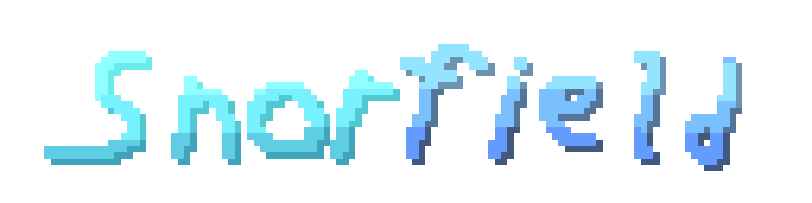

<div align="center">
  
  &nbsp;&nbsp;
  
  &nbsp;&nbsp;
  
  &nbsp;&nbsp;
  
  &nbsp;&nbsp;
  
  &nbsp;&nbsp;
  
  &nbsp;&nbsp;
  
  &nbsp;&nbsp;
  
  &nbsp;&nbsp;
  
  &nbsp;&nbsp;
  
  &nbsp;&nbsp;
  
  &nbsp;&nbsp;
  
</div>

<br>

<div align="center">
<!-- DAILY_QUOTE_START -->
“𝐓𝐚𝐥𝐤 𝐢𝐬 𝐜𝐡𝐞𝐚𝐩. 𝐒𝐡𝐨𝐰 𝐦𝐞 𝐭𝐡𝐞 𝐜𝐨𝐝𝐞.” – 𝐋𝐢𝐧𝐮𝐬 𝐓𝐨𝐫𝐯𝐚𝐥𝐝𝐬
<!-- DAILY_QUOTE_END -->
</div>

<br>

```cmd
> cat snorfield.txt

Hey there, Snorfield here! I'm a Canadian software engineer, graphic designer, artist, and musician.

Tools I Use
├── C++
├── JavaScript
│   ├── Node.js
│   ├── Discord.js
│   └── Express.js
├── HTML
│   └── CSS
├── GLSL
├── Python
├── SQLite
├── Blender
├── Figma
└── Scratch
```

<div align="center">
  
  
  <a href="https://github.com/snorfield/dither">
  
</a>
</div>


